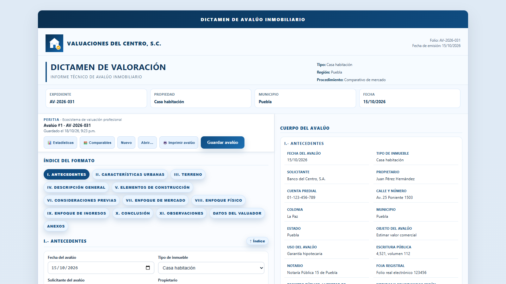
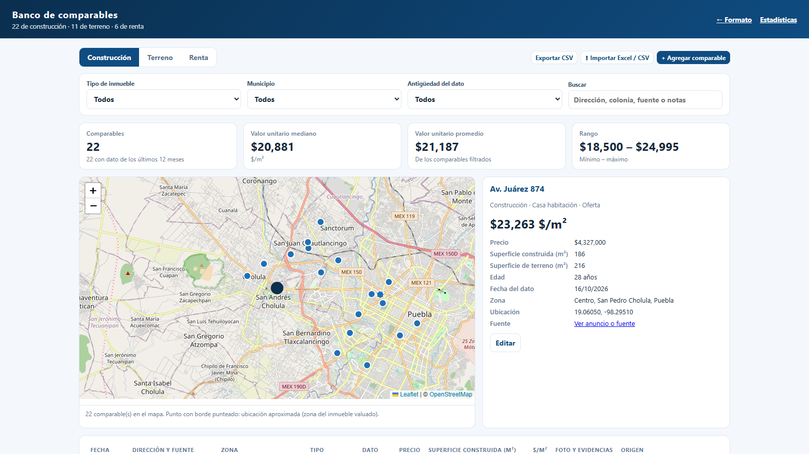

# PERITIA · Ecosistema de valuación profesional

Sistema para elaborar avalúos inmobiliarios: captura en oficina y en campo, cálculo de los tres enfoques de valor, dictamen impreso o en PDF, banco de comparables y estadísticas. El código vive en el repositorio AVALUO-FORMATO.

Created and developed by Hugo Landeros Rizo.



## Cómo probarlo en 3 pasos
Requisitos: Node.js 24 o posterior (https://nodejs.org) y Chrome o Edge.

```
git clone https://github.com/hugolanderos67-arch/AVALUO-FORMATO.git
cd AVALUO-FORMATO
npm install
npm start
```

1. Abra http://localhost:3000 y capture un avalúo (o use "Abrir…" para uno guardado).
2. Presione "🖨️ Imprimir avalúo" para ver el dictamen en hoja carta o guardarlo en PDF.
3. Revise "🏘️ Comparables" y "📊 Estadísticas", que se alimentan de los avalúos guardados.

Pruebas automáticas de cálculos y almacenamiento: `npm test`.
En Windows también se puede instalar con doble clic en `instalar.bat`, que crea el ícono "PERITIA" en el escritorio.
La extracción de datos de PDF con IA es opcional y necesita la variable `ANTHROPIC_API_KEY` (ver más abajo); todo lo demás funciona sin ella.

## Módulos
| Módulo | Dónde está |
|---|---|
| Formato de captura y dictamen | `AVALUO-FORMATO.html`, `frontend/technical-descriptions.js`, `frontend/finishes-catalog.js`, `frontend/date-field.js` (fechas siempre en dd/mm/aaaa) |
| Motor de valuación (enfoques físico, de mercado y de ingresos) | `backend/valuation/` |
| Ubicación, equipamiento urbano y documentos de planeación | `backend/valuation/urban-*.js` |
| Extracción de datos con IA (Claude, de Anthropic) | `backend/valuation/document-extraction.js` |
| Expedientes y base de datos SQLite | `backend/db/` |
| Banco de comparables e importación Excel/CSV | `frontend/comparables.html`, `backend/db/comparables-*.js` |
| Estadísticas | `frontend/estadisticas.html` |
| App móvil PERITIA Campo | `mobile/` |
| Servidor y API | `server.js` |
| Pruebas | `tests/` |



## Arquitectura propuesta

### Frontend
- HTML/CSS/JS simple para captura de datos y vista de resultados.
- Se puede reemplazar por React o Vue en una siguiente fase.

### Backend
- Node.js + HTTP Server para exponer la API de valuación.
- Lógica de homologación en backend/valuation/homologation.js.

### Base de datos
- SQLite mediante el módulo `node:sqlite` incluido en Node.js 24 (sin dependencias adicionales). Esquema en `backend/db/schema.sql`.
- Tabla `avaluos`: la captura completa se guarda como JSON en `datos`; folio, fechas, solicitante, ubicación y valor concluido se guardan además en columnas para listar y buscar.
- Tabla `archivos`: fotografías, imágenes de comparables, firma y logotipo. Las imágenes se guardan en disco y la captura solo conserva su referencia (`/api/archivos/{id}`).
- Los datos viven en la carpeta `data/` (base `avaluos.db` y carpeta `archivos/`), excluida de git. Para respaldar todos los avalúos, copie esa carpeta con el servidor detenido. Se puede cambiar la ubicación con la variable `AVALUOS_DATA_DIR`.
- API: `GET/POST /api/avaluos`, `GET/PUT/DELETE /api/avaluos/{id}` y `GET /api/archivos/{id}`.

### Fórmulas
Enfoque comparativo de mercado, cuadro "Análisis por homologación y ajustes" (`backend/valuation/market-comparables.js`):
- Valor unitario de cada comparable: $VU = P_v / S$
- Factor resultante: $FRe = FZo \times FUb \times FSu \times FEd \times FCo \times FPr \times FOt \times FNeg$ (zona, ubicación, superficie, edad, conservación, proyecto, otro y negociación; un factor vacío vale 1)
- Valor ajustado: $VA = VU \times FRe$; componente del valor: $VA \times Pond$
- Valor unitario ajustado y ponderado: $VUP = \sum (VA \times Pond)$. Sin ponderación capturada, todos los comparables pesan igual; si las capturadas no suman 100 %, se ajustan en proporción y el dictamen lo indica.
- Valor de mercado: $V_m = VUP \times S_{sujeto} \times$ ajuste de mercado
- Enfoque físico, depreciación de construcciones y accesorios (Ross-Heidecke): $F.R.H. = [1 - \tfrac{1}{2}(e/V + (e/V)^2)] \times (1 - K/100)$, con $e$ = edad, $V$ = edad + vida útil remanente y $K$ de la tabla de Heidecke según el estado de conservación elegido: 1 nuevo 0 %, 1.5 0.032 %, 2 regular (normal) 2.52 %, 2.5 8.09 %, 3 reparaciones sencillas 18.10 %, 3.5 33.20 %, 4 reparaciones importantes 52.60 %, 4.5 75.20 %, 5 sin valor 100 %. Los estados guardados con los nombres anteriores (Bueno, Regular, Malo, Ruinoso) se abren con su mismo coeficiente.
- Comparables de terreno (enfoque físico) y de renta (enfoque de ingresos): valor homologado = valor unitario × los factores propios de cada grupo, con la misma ponderación por comparable; el resultado es la suma de componentes.
- Aplicación del resultado: si "Valor unitario de terreno" o "Renta unitaria mensual" quedan vacíos, el cálculo usa automáticamente el valor homologado de sus comparables; si el valuador captura un valor, se usa el capturado y la pantalla avisa cuando difiere del homologado.
- Dictamen: cada enfoque abre con un recuadro "¿Cómo se obtiene este valor?" en lenguaje sencillo y muestra sus pasos (comparables, homologación y aplicación al inmueble). El enfoque físico incluye el cuadro "Cálculo del valor físico" (terreno, cada construcción con V.R.N. × F.R.H. y accesorios) y la conclusión explica en una línea cómo se obtuvo cada valor.

## Abrir el sistema como aplicación
- Ícono "PERITIA" en el escritorio y en el menú Inicio (`scripts/iniciar-avaluo.ps1`): enciende el servidor en segundo plano si no está encendido (registros en `data/servidor.log` y `data/servidor-errores.log`) y abre el formato en una ventana propia de Chrome o Edge.
- "Detener PERITIA" en el escritorio y en el menú Inicio (`scripts/detener-avaluo.ps1`) apaga el servidor.
- Los íconos se crean con `instalar.bat` (revisa que Node.js 24+ esté instalado) o con `scripts/crear-accesos-directos.ps1`.

## Folio y estatus del avalúo
- Hay dos números. "Avalúo #N" es el número interno que la base asigna al guardar por primera vez: consecutivo y nunca reutilizado, aunque se elimine un avalúo. El **folio del expediente** es el número de control que aparece en el dictamen.
- Folio sugerido: en un avalúo nuevo se propone el siguiente consecutivo del año, `AV-aaaa-nnn` (por ejemplo AV-2026-007), contando también los cancelados; se puede cambiar. El folio es único (sin importar mayúsculas): el formato avisa al escribir uno repetido y el servidor no guarda un avalúo con folio de otro (`GET /api/avaluos/folio?anio=&folio=&excluir=`). Las visitas de campo no se rechazan por folio repetido.
- Estatus ("Estatus…" en la barra del formato; `PUT /api/avaluos/{id}/estatus`): en proceso, concluido o cancelado con motivo. Un cancelado conserva su folio, sigue en "Abrir…", no cuenta en las estadísticas, no aparece en la app móvil y su dictamen muestra el aviso y se imprime con la leyenda "CANCELADO" en cada hoja. Un concluido no se puede eliminar; para retirarlo se cancela. "Eliminar" queda para pruebas o errores de captura.

## Imprimir el dictamen
- Botón "🖨️ Imprimir avalúo" de la barra del formato (o Ctrl+P): actualiza el dictamen, espera a que carguen logotipo, firma, mapas y fotos, y abre el diálogo de impresión del navegador. Ahí se elige la impresora o "Guardar como PDF"; en "Más opciones" conviene activar "Gráficos de fondo".
- En hoja carta se imprime con el acomodo de escritorio: datos a dos columnas, tablas completas con encabezado repetido, fotos y croquis grandes, mapa de entorno (sección II) y de macrolocalización (Anexo II). Cada hoja lleva los datos del valuador, "Página X de Y" y el crédito "Elaborado con PERITIA · Created and developed by Hugo Landeros Rizo".

## Compartir con otra persona
- Instalación propia (cada quien con su base de datos): `scripts/crear-paquete.ps1` genera en el escritorio un ZIP con la última versión guardada en git, sin la carpeta `data`. Quien lo recibe sigue `INSTALAR.txt`: instalar Node.js 24+, descomprimir y abrir `instalar.bat`.
- Mismo sistema y mismos datos: compartir esta computadora por Tailscale (consola de Tailscale, "Machines", la PC, "Share…") y abrir `https://<nombre-de-la-pc>.<red>.ts.net`. No hay usuarios ni contraseñas: quien tenga acceso ve y edita todos los avalúos, y el perfil del valuador es uno solo.

## Ejecución
- `npm test`
- `node server.js`

## Ubicación por coordenadas
- Al capturar latitud y longitud WGS84, el formato consulta Nominatim para obtener la referencia cartográfica más cercana y completar calle, colonia, municipio, estado y contexto vial cuando estén disponibles.
- La ubicación se presenta en un mapa con marcador. Las teselas visibles se solicitan al servicio estándar de OpenStreetMap, se sirven desde el backend con caché y conservan la atribución requerida.
- La consulta se activa por captura del usuario, utiliza caché en memoria y limita su frecuencia. Se puede cambiar el endpoint con `NOMINATIM_URL`; personalizar la identificación HTTP con `NOMINATIM_USER_AGENT` y definir un contacto con `NOMINATIM_EMAIL`.
- OpenStreetMap puede asociar la coordenada con el objeto cartográfico adecuado más cercano; confirma la ubicación en campo. La geocodificación no proporciona zonificación oficial, población censal, densidad permitida, nivel socioeconómico, ancho de calle ni banquetas. Completa esos campos con fuentes oficiales o verificación documental.
- Equipamiento urbano: con las coordenadas se consulta la API Overpass de OpenStreetMap en un radio de 2 km y se llenan las casillas de educación, cultura, salud, comercio y abasto, transporte, recreación y deporte, seguridad pública, infraestructura y servicios, y el resumen de equipamiento, con el lugar más cercano de cada tipo y su distancia en línea recta. Solo se llenan casillas vacías o llenadas por una búsqueda anterior; lo escrito a mano se respeta. Se prueban varios servidores públicos de Overpass en orden (o uno propio con `OVERPASS_URL`) y los resultados se guardan en memoria 7 días. Las redes de agua, drenaje, electricidad y alumbrado no provienen de esta fuente.
- Conserva la atribución a OpenStreetMap indicada en el formato y atiende su [política de uso de Nominatim](https://operations.osmfoundation.org/policies/nominatim/).
- En el apartado urbano se pueden seleccionar hasta cinco archivos PDF, DOCX o TXT, de máximo 100 MB por archivo. El texto se extrae en memoria; se muestran únicamente coincidencias con etiquetas reconocidas, junto con archivo y evidencia, para que la persona valuadora seleccione qué valores aplicar. Los campos con captura previa no se sobrescriben. PDF escaneados requieren OCR externo.

## Banco de comparables
- Pantalla en `/comparables` (botón "🏘️ Comparables" del formato), separada en construcción, terreno y renta, con filtros por tipo de inmueble, municipio, antigüedad del dato y búsqueda; mediana, promedio y rango del valor unitario; captura y edición directa, y exportación CSV.
- Al guardar un avalúo, cada comparable con precio y superficie se agrega o actualiza en la tabla `banco_comparables` (clave `avalúo:grupo:índice`, sin duplicar). Cada tarjeta de comparable tiene "Datos para el banco de comparables": tipo de dato (oferta, venta, renta), fecha, fuente o enlace, coordenadas y, en construcción, edad y superficie de terreno. Sin coordenadas propias, se ubica en la zona del inmueble sujeto (marcado como aproximado).
- Evidencias de la fuente: cada tarjeta de comparable tiene "📎 Agregar evidencia" para capturas de pantalla del portal, imágenes o PDF (varias por comparable). Se guardan con el avalúo, aparecen en el dictamen junto a las fotografías de los comparables y pasan al banco, donde también se pueden agregar o quitar al capturar o editar un comparable.
- Las tarjetas de comparables piden los mismos datos que el banco: en "Datos para el banco de comparables" van tipo de inmueble (salvo terreno), colonia, municipio, estado, fuente, edad (construcción), coordenadas y notas. Tipo de inmueble y zona vacíos toman los del inmueble valuado (el campo lo indica). "➕ Capturar en el banco" abre el banco en otra pestaña con el formulario del grupo listo (`/comparables?nuevo=construccion|terreno|renta`).
- Usar comparables del banco en un avalúo: en los tres enfoques (comparables de construcción del enfoque de mercado, de terreno del físico y de renta del de ingresos), "🏘️ Elegir comparables del banco" abre el banco filtrado por tipo de inmueble, municipio, antigüedad del dato (12 meses por omisión) y búsqueda, ordenado del más cercano al más lejano al inmueble sujeto; los elegidos llenan las tarjetas libres. Cada tarjeta tiene además "Traer del banco" para llenarla o reemplazarla con uno en particular, y "Vaciar tarjeta". Se copian dirección, precio, superficie, datos del banco, fotos y evidencias; los factores de homologación quedan en 1 para que el valuador los ajuste. La tarjeta guarda el número del comparable (`bancoId`) y por eso no se vuelve a agregar al banco al guardar; el avalúo guarda copia propia de las fotos y evidencias.
- Clonar un comparable con otro dato (el mismo inmueble en venta y en renta, o una oferta que después se vendió): en el formato, "⧉ Clonar como…" de cada tarjeta lo copia a la primera tarjeta libre del mismo grupo o del otro (construcción ↔ renta) con dirección, superficies, edad, ubicación y fotos; en el banco, "Clonar" abre el formulario con los datos del inmueble y permite cambiar el tipo de comparable. Precio o renta, tipo y fecha del dato, fuente y evidencias se capturan de nuevo porque son propios de cada anuncio; el clon se guarda como un comparable distinto.
- Comparables de construcción: "Superficie de terreno (m²)" está a la vista en cada tarjeta y aparece en la tabla de comparables del dictamen, solo como referencia; no interviene en la homologación.
- Lo que se edita o quita en el banco no se sobrescribe ni regresa con los siguientes guardados del avalúo. Al eliminar un avalúo, sus comparables permanecen en el banco con una copia propia de sus fotos y evidencias (tabla `banco_archivos`, carpeta `data/archivos/banco`).
- Importación masiva ("⬆ Importar Excel / CSV"): archivos .xlsx o .csv de hasta 5,000 filas, con plantilla descargable (`/api/comparables/plantilla.csv`). Reconoce encabezados equivalentes, números con formato de pesos y fechas dd/mm/aaaa o de Excel; muestra una vista previa con filas válidas, errores por fila y duplicados (contra el banco y dentro del archivo) y solo importa al confirmar, en una sola transacción. Lectura de Excel con `read-excel-file` (`backend/db/comparables-import.js`).
- API: `GET/POST /api/comparables` (filtros `categoria`, `tipo`, `municipio`, `q`), `PUT/DELETE /api/comparables/{id}` y `POST /api/comparables/importar` (multipart: `archivo`, `categoria`, `confirmar=1`).
- Mapa (Leaflet, servido desde `node_modules/leaflet` en `/vendor/leaflet`, con los mosaicos de OpenStreetMap del proxy `/api/map-tiles`): un punto por comparable filtrado; al elegirlo en el mapa o en la tabla se muestra su ficha. Los comparables que comparten ubicación aproximada se abren en círculo para poder elegirlos uno por uno. El mismo mapa (`frontend/mapa-resumen.js`) está en Estadísticas para los avalúos con coordenadas.

## Estadísticas
- Tablero en `/estadisticas` (botón "📊 Estadísticas" del formato), calculado en vivo desde la base de datos (`GET /api/estadisticas`): valor total, promedio y mediano concluido, valor unitario promedio, avalúos por mes, valor promedio por tipo de inmueble, $/m² por municipio o colonia, enfoque concluido y solicitantes, con filtros por periodo, tipo, municipio y estado, y tabla de detalle.
- El valor unitario se calcula sobre la superficie construida; en terrenos sin construcción, sobre la superficie de terreno.
- "Exportar CSV" descarga la selección filtrada en UTF-8 para abrirla en Excel o Power BI.

## App móvil para la visita de campo
- Página instalable en `/movil` (`mobile/`): captura descripción general, elementos de la construcción, acabados e instalaciones, más fotos, croquis y notas. Las listas y opciones se leen del propio formato (`AVALUO-FORMATO.html` y `frontend/finishes-catalog.js`), así que cualquier cambio en el formato llega solo a la app.
- Funciona sin señal: un service worker (`movil-sw.js`) guarda la app y el formato, y las visitas con sus fotos (reducidas a 1600 px en JPEG) se guardan en el celular (IndexedDB).
- Al sincronizar, las fotos se suben a `/api/cargas` y la visita se envía a `POST /api/visitas`: crea un avalúo nuevo o se aplica a uno existente. Los valores capturados en campo reemplazan a los del avalúo (los vacíos no borran nada), las fotos y croquis se agregan, y las notas llegan a "Notas de la visita de campo" (sección V, no se imprimen). Cada visita tiene un identificador para no aplicarse dos veces.
- Cada avalúo lleva un número de revisión: si una visita se sincroniza mientras el avalúo está abierto en la computadora, al guardar se avisa en lugar de sobrescribir lo que llegó del celular.
- Pestaña "Consultar avalúos" (requiere conexión con la oficina): busca por folio, solicitante, propietario, calle, colonia o municipio y muestra folio, estatus, fecha, dirección y valor concluido. La ficha de cada avalúo muestra el valor concluido, los tres valores por enfoque (se guardan en `datos.resumenValores` al guardar en la oficina), los datos generales y las fotos, con "Ver dictamen completo" y "Nueva visita a este avalúo". Es solo lectura.
- "Ver dictamen completo" abre `/?avaluo=ID&vista=dictamen`: solo el dictamen, sin la captura y con los campos bloqueados, con botones para volver y para guardar en PDF o compartir.
- Acceso desde el celular con Tailscale (HTTPS privado, solo para los dispositivos de la cuenta): instalar Tailscale en la PC y en el celular con la misma cuenta, activar "MagicDNS" y "HTTPS Certificates" en login.tailscale.com/admin/dns, y en la PC ejecutar una vez `tailscale serve --bg http://127.0.0.1:3000`. La app queda en `https://<nombre-de-la-pc>.<red>.ts.net/movil`.
- El servidor escucha solo en este equipo (`127.0.0.1`); con `HOST=0.0.0.0` vuelve a aceptar conexiones de la red local, sin cifrado.

## Extracción de datos de documentos PDF con IA
- En Anexos, los PDF de croquis y documentos muestran el botón "Extraer datos". Se eligen las páginas a enviar y se confirma que los datos personales están tapados de forma permanente; el servidor recorta el PDF a esas páginas y lo envía al modelo Claude de Anthropic (`claude-opus-5-5` por omisión; se cambia con `ANTHROPIC_MODEL`), con respaldo automático de modelo si la solicitud es declinada.
- Los anexos se suben al servidor al agregarlos (`POST /api/cargas`, hasta 200 MB por archivo; ajustable con `MAX_UPLOAD_MB`) y se ligan al avalúo al guardarlo; las subidas que nunca se guardan se depuran a las 48 horas. La API de Anthropic admite unos 32 MB por solicitud, por lo que las páginas enviadas en cada extracción deben sumar ~22 MB o menos; con documentos más pesados se extrae por tramos de páginas.
- Cada dato propuesto trae la cita textual y la página. Si el PDF tiene texto seleccionable, el servidor comprueba que la cita exista; los datos sin cita comprobable quedan desmarcados. En PDF escaneados las citas no se pueden comprobar automáticamente y deben revisarse contra el documento.
- Los datos solo se aplican a campos vacíos y quedan registrados con su cita en Antecedentes del dictamen.
- Requiere la variable de entorno `ANTHROPIC_API_KEY` en el equipo del servidor. En Windows (PowerShell): `[Environment]::SetEnvironmentVariable('ANTHROPIC_API_KEY', 'su-clave', 'User')`, y después cerrar y volver a abrir `start-server.bat`. La clave nunca se escribe en el código.

## Notas de cumplimiento
- Se deja preparada la estructura para integrar reglas SHF/INDAABIN.
- La lógica de homologación debe ampliarse con factores regulatorios y validaciones de documentos.
